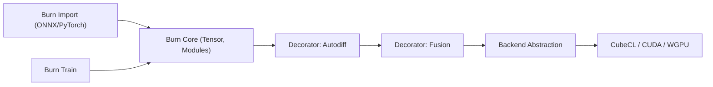

# tracel-ai/burn

> Tensor library and deep learning framework in Rust, training and inference with the same code.

## The problem
Training in Python then exporting to ONNX or TensorRT is fragile and loses complex architectures.

## What it actually does
A single tensor API over several backends (CubeCL: CUDA, ROCm, Metal, Vulkan, WebGPU, CPU; Flex for no_std and WebAssembly) wrapped by decorators for autodiff, kernel fusion and remote execution. ONNX import (burn-onnx, limited operators), PyTorch and Safetensors; terminal training dashboard.

## How it is wired

## Trying it
No shell command in the README; Rust snippets (`nn` module, WebSocket remote server) and a pointer to the Burn Book. The README text is truncated at the Backend section.

## Cost and gotchas
Free; Rust compiler, GPU for acceleration. Active development with breaking changes: old records (.mpk, .bin) no longer load in 0.22.

## What it is not
Not a replacement for PyTorch in ecosystem maturity: the README acknowledges that the Rust AI ecosystem is young.

## Alternatives
The README cites candle, tract and ort (inference), mistral.rs, linfa and smartcore (classical ML).

## For you
Watch: interesting for deploying models on device or in the browser from a single Rust codebase; too young to replace your Python stack.
