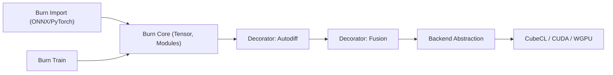

# tracel-ai/burn

> Bibliothèque de tenseurs et framework d'apprentissage profond en Rust, entraînement et inférence avec le même code.

## Le problème
Entraîner en Python puis exporter vers ONNX ou TensorRT est fragile et fait perdre des architectures complexes.

## Ce que ça fait vraiment
API de tenseurs unique sur plusieurs backends (CubeCL : CUDA, ROCm, Metal, Vulkan, WebGPU, CPU ; Flex pour no_std et WebAssembly) décorés par autodiff, fusion de noyaux, exécution distante. Import ONNX (burn-onnx, opérateurs limités), PyTorch et Safetensors ; tableau de bord d'entraînement dans le terminal.

## Comment c'est branché

## Essayer
Aucune commande shell dans le README ; extraits Rust (module `nn`, serveur distant WebSocket) et renvoi au Burn Book. Le texte du README est tronqué à la section Backend.

## Coût et pièges
Gratuit ; compilateur Rust, GPU pour l'accélération. Développement actif avec ruptures de compatibilité : les anciens enregistrements (.mpk, .bin) ne se chargent plus en 0.22.

## Ce que ce n'est pas
Pas un remplaçant de PyTorch en maturité d'écosystème : le README reconnaît que l'écosystème Rust IA est jeune.

## Alternatives
Le README cite candle, tract et ort (inférence), mistral.rs, linfa et smartcore (ML classique).

## Pour toi
À surveiller : intéressant pour déployer des modèles sur appareil ou navigateur depuis une seule base Rust ; trop jeune pour remplacer ton stack Python.

