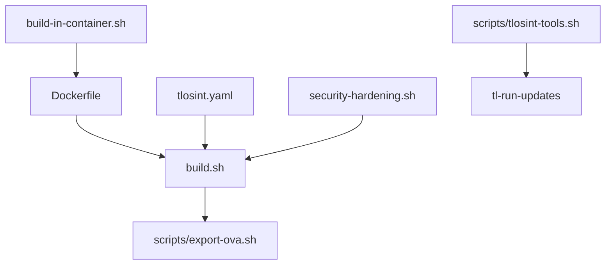

# tracelabs/tlosint-vm

> Trace Labs Kali virtual machine for OSINT investigations, with a tool installation script.

## The problem
Setting up a clean, hardened, fully equipped OSINT workstation takes hours.

## What it actually does
A build recipe derived from kali-vm that produces an OVA image (VirtualBox, VMware, qcow2 for Apple Silicon). The `tlosint-tools.sh` script installs Sherlock, SpiderFoot, maigret, yt-dlp and others on demand, and hardens Firefox. The TL-Vault Obsidian vault is preloaded.

## How it is wired


## Trying it
```bash
git clone https://github.com/tracelabs/tlosint-vm
cd tlosint-vm
chmod +x build-in-container.sh
./build-in-container.sh
```

## Cost and gotchas
Free. The build assumes Docker and an Intel machine. The default login is osint/osint: change it. Check the SHA-256 sums of the images.

## What it is not
Not an attack suite: the tools are for gathering public information. The minimal image does not contain the tools, which are installed separately.

## Alternatives
No alternative named in the README.

## For you
Keep an eye on it: useful for open-source investigations or monitoring work, of little relevance to day-to-day data / AI / MLOps.
