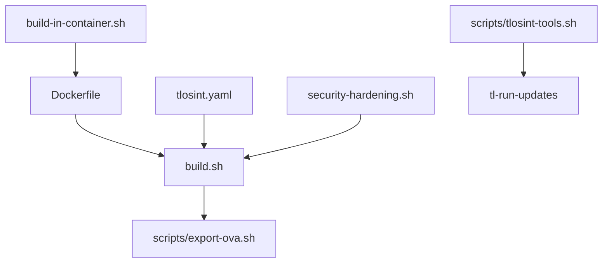

# tracelabs/tlosint-vm

> Machine virtuelle Kali pour enquêtes OSINT de Trace Labs, avec script d'installation d'outils.

## Le problème
Monter un poste d'enquête OSINT propre, durci et outillé prend des heures.

## Ce que ça fait vraiment
Une recette de build dérivée de kali-vm qui produit une image OVA (VirtualBox, VMware, qcow2 pour Apple Silicon). Le script `tlosint-tools.sh` installe à la demande Sherlock, SpiderFoot, maigret, yt-dlp et d'autres, et durcit Firefox. Le coffre Obsidian TL-Vault est préchargé.

## Comment c'est branché


## Essayer
```bash
git clone https://github.com/tracelabs/tlosint-vm
cd tlosint-vm
chmod +x build-in-container.sh
./build-in-container.sh
```

## Coût et pièges
Gratuit. Le build suppose Docker et une machine Intel. L'identifiant par défaut est osint/osint : à changer. Vérifier les sommes SHA-256 des images.

## Ce que ce n'est pas
Pas une suite d'attaque : les outils servent à la collecte d'information publique. L'image minimale ne contient pas les outils, qui sont installés à part.

## Alternatives
Aucune alternative nommée dans le README.

## Pour toi
Surveiller : utile pour des enquêtes de sources ouvertes ou de la veille, peu pertinent pour le quotidien data / IA / MLOps.

