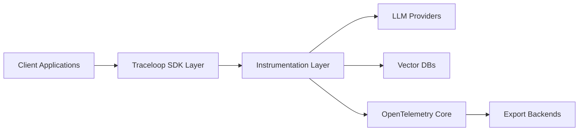

# traceloop/openllmetry

> OpenTelemetry instrumentations for tracing LLM calls, vector databases and agent frameworks.

## The problem
LLM calls escape existing observability: no latency, tokens or prompts in Datadog or Honeycomb.

## What it actually does
Standard OTel instrumentations for OpenAI, Anthropic, Bedrock, Gemini, Ollama, Mistral…
Vector databases (Chroma, Pinecone, Qdrant, Weaviate, Milvus…) and frameworks (LangChain, LlamaIndex, CrewAI, LangGraph…), plus MCP.
A `traceloop-sdk` SDK that initializes in one line and produces standard OTel data.
The instrumentations can be used on their own if OTel is already in place.

## How it is wired


## Trying it
```bash
pip install traceloop-sdk
```

## Cost and gotchas
Free; you need an observability backend (your own or a SaaS). Versions prior to 0.49.2 collected telemetry.

## What it is not
Not a backend or a dashboard: it produces traces, to be sent elsewhere. 680 open issues.

## Alternatives
- OpenLLMetry-JS: the JS/TS version.

## For you
Adopt to instrument your LLM applications: it is standard OpenTelemetry, so no lock-in, and it plugs into existing observability.
