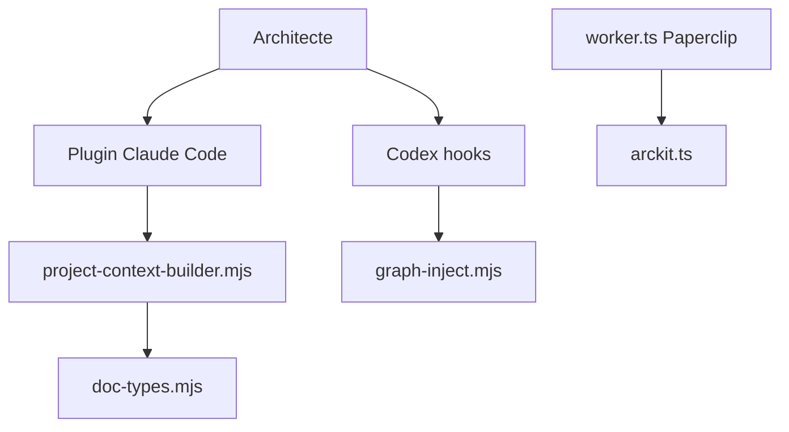

# tractorjuice/arc-kit

> A toolkit for enterprise architects that generates governance documents through an AI assistant.

## The problem
Architecture documents are scattered and their traceability gets lost between requirements, risks and design.

## What it actually does
A collection of commands (76 for the core) that ask an AI assistant to draft documents: principles, stakeholders, risks, business case, requirements, data model, diagrams, procurement. It installs as a Claude Code plugin, as a Gemini or Mistral Vibe extension, or via the arckit command for Copilot, Codex and Kimi. Hooks compute the project context and a traceability graph.

## How it is wired


## Trying it
```bash
claude install latest
claude plugin install arckit@arckit-claude
pip install git+https://github.com/tractorjuice/arc-kit.git
arckit init payment-modernization --ai copilot
```

## Cost and gotchas
The commands consume your assistant's tokens: about 10,000 permanent tokens per session, up to 60,000 per heavy command. A licence is present but not identified, and part of the plugins is proprietary.

## What it is not
Not legal, regulatory or security advice: all outputs are drafts to be reviewed by a qualified person. It mainly targets the UK public sector and its frameworks (Green Book, Orange Book).

## Alternatives
No alternative named in the README.

## For you
Ignore: an enterprise-architecture tool, heavy on tokens with an unclear licence, far from data, AI or MLOps work.
