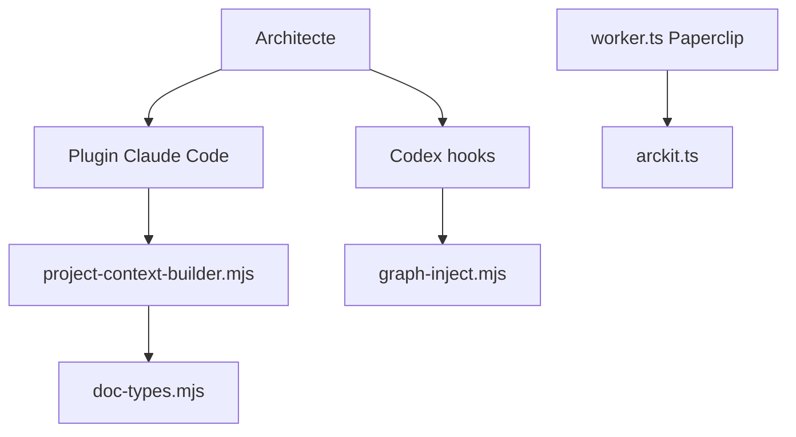

# tractorjuice/arc-kit

> Une boîte à outils pour architectes d'entreprise qui génère des documents de gouvernance via un assistant IA.

## Le problème
Les documents d'architecture sont dispersés et leur traçabilité se perd entre exigences, risques et conception.

## Ce que ça fait vraiment
Une collection de commandes (76 pour le noyau) qui demandent à un assistant IA de rédiger des documents en brouillon : principes, parties prenantes, risques, analyse de rentabilité, exigences, modèle de données, diagrammes, achats. Elle s'installe en plugin Claude Code, en extension Gemini ou Mistral Vibe, ou via la commande arckit pour Copilot, Codex et Kimi. Des crochets (hooks) calculent le contexte du projet et un graphe de traçabilité.

## Comment c'est branché


## Essayer
```bash
claude install latest
claude plugin install arckit@arckit-claude
pip install git+https://github.com/tractorjuice/arc-kit.git
arckit init payment-modernization --ai copilot
```

## Coût et pièges
Les commandes consomment des jetons de ton assistant : environ 10 000 jetons permanents par session, jusqu'à 60 000 par commande lourde. Licence présente mais non identifiée, et une partie des plugins est propriétaire.

## Ce que ce n'est pas
Pas un conseil juridique, réglementaire ou de sécurité : toutes les sorties sont des brouillons à relire par une personne qualifiée. Il cible surtout le secteur public britannique et ses cadres (Green Book, Orange Book).

## Alternatives
Aucune alternative nommée dans le README.

## Pour toi
À ignorer : outil d'architecture d'entreprise, lourd en jetons et à licence floue, éloigné du travail data, IA ou MLOps.

