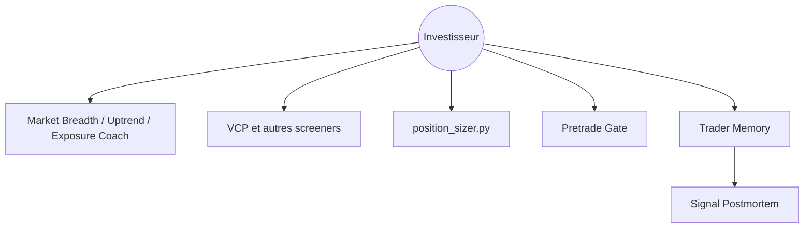

# tradermonty/claude-trading-skills

> Toolbox of Claude skills for individual investors: market watch, risk, trade journal.

## The problem
Structuring your market review, position sizing and trading journal takes a lot of manual discipline.

## What it actually does
A catalogue of dozens of skills (market regime, portfolio, dividends, swing, trade planning, trade memory, strategy research) described in `skills-index.yaml`, with YAML workflows. A starter path that needs no API key uses five skills and public CSVs. Screening skills often require an FMP key. It places no orders and does not replace human decision-making.

## How it is wired


## Trying it
The README gives no single command; it describes a manual copy:
```bash
git clone https://github.com/tradermonty/claude-trading-skills
cp -r skills/backtest-expert ~/.claude/skills/
```
Or upload a `.skill` file in the Skills tab of Claude web. The `git clone` and `cp` commands above are a transcription of the described procedure, with no literal URL in the excerpt.

## Cost and gotchas
The FMP, FINVIZ Elite or Alpaca skills require a subscription or a key at your expense. The README states "no financial advice" and that capital losses are possible.

## What it is not
Not a signals service or a trading bot. The repository's judgments come from a single author and guarantee no return.

## Alternatives
No alternative named in the README.

## For you
Ignore for a data/AI/MLOps profile: the content is personal finance, unrelated to your work, despite a good level of organization.
