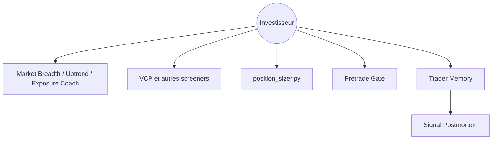

# tradermonty/claude-trading-skills

> Boîte à outils de skills Claude pour investisseurs individuels : veille de marché, risque, journal de trades.

## Le problème
Structurer sa revue de marché, son dimensionnement de positions et son journal de trading demande beaucoup de discipline manuelle.

## Ce que ça fait vraiment
Un catalogue de dizaines de skills (régime de marché, portefeuille, dividendes, swing, planification de trade, mémoire de trades, recherche de stratégies) décrit dans `skills-index.yaml`, avec des workflows YAML. Un parcours de départ sans clé d'API utilise cinq skills et des CSV publics. Les skills de screening exigent souvent une clé FMP. Il ne passe aucun ordre et ne remplace pas la décision humaine.

## Comment c'est branché


## Essayer
Le README ne donne pas de commande unique ; il décrit une copie manuelle :
```bash
git clone https://github.com/tradermonty/claude-trading-skills
cp -r skills/backtest-expert ~/.claude/skills/
```
Ou téléverser un fichier `.skill` dans l'onglet Skills de Claude web. Les commandes `git clone` et `cp` ci-dessus sont une transcription de la procédure décrite, sans URL littérale dans l'extrait.

## Coût et pièges
Les skills FMP, FINVIZ Elite ou Alpaca demandent un abonnement ou une clé à ta charge. Le README précise « pas de conseil financier » et des pertes en capital possibles.

## Ce que ce n'est pas
Pas un service de signaux ni un robot de trading. Les jugements du dépôt viennent d'un seul auteur et ne garantissent aucun rendement.

## Alternatives
Aucune alternative nommée dans le README.

## Pour toi
À ignorer pour un profil data/IA/MLOps : le contenu est de la finance personnelle, sans lien avec ton travail, malgré un bon niveau d'organisation.

