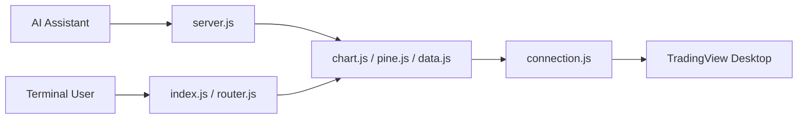

# tradesdontlie/tradingview-mcp

> MCP server and CLI driving TradingView Desktop via the Chrome DevTools Protocol, for Claude Code.

## The problem
An AI agent can neither read nor manipulate the charts, indicators and Pine scripts of a local TradingView application.

## What it actually does
Connects to TradingView Desktop launched with `--remote-debugging-port=9222` and runs JavaScript via CDP.
78+ MCP tools: reading state and indicators, changing symbol, drawings, alerts, replay, panels, screenshots.
Pine Script development (injection, compilation, errors); JSONL streaming by polling.
Every tool also exists as a `tv` CLI command with JSON output.

## How it is wired


## Trying it
```bash
git clone https://github.com/tradesdontlie/tradingview-mcp.git
cd tradingview-mcp
npm install
./scripts/launch_tv_debug_linux.sh
node src/cli/index.js <command>
npm test
```

## Cost and gotchas
Paid TradingView subscription; uses undocumented internal APIs that break with every update.
Use possibly contrary to TradingView's terms (the README says so itself).

## What it is not
Not a trading bot: no real order execution.
Not affiliated with TradingView, nor stable over time.

## Alternatives
No alternative named in the README.

## For you
Ignore: fragile, legally risky and niche; only the pattern "Electron app made readable to an agent via CDP" is worth keeping.
