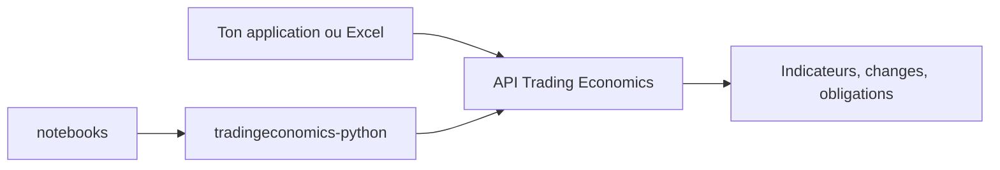

# tradingeconomics/tradingeconomics

> Landing page of examples for the Trading Economics API: indicators, currencies, rates and commodities.

## The problem
Fetching macroeconomic and market series in a uniform way, without collecting them one by one.

## What it actually does
The repository only contains an introduction and links: documentation, examples, a Python client, notebooks, Docker images. The API advertises 300,000 indicators, XML, CSV or JSON exports, usable from an app or from Excel.

## How it is wired
Simplified diagram based on the sheet, no diagram provided.



## Trying it
```bash
# Aucune commande dans le README : ouvrir https://docs.tradingeconomics.com/
# puis le client Python https://github.com/tradingeconomics/tradingeconomics-python
```

## Cost and gotchas
The README says nothing about pricing or keys: data access goes through a commercial service, to be checked on their site. No license in the repository.

## What it is not
It is not an installable tool nor an open dataset: it is a showcase for a third-party API. The README is too short to judge the real coverage.

## Alternatives
No alternative mentioned in the README.

## For you
Keep an eye on it: useful if you need macro data for features, but the repository only provides links and the access model needs to be confirmed.
