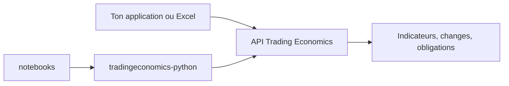

# tradingeconomics/tradingeconomics

> Page d'accueil d'exemples pour l'API Trading Economics : indicateurs, changes, taux et matières premières.

## Le problème
Récupérer des séries macroéconomiques et de marché de façon uniforme, sans les collecter une par une.

## Ce que ça fait vraiment
Le dépôt ne contient qu'une introduction et des liens : documentation, exemples, client Python, notebooks, images Docker. L'API annonce 300 000 indicateurs, exports XML, CSV ou JSON, utilisables depuis une appli ou Excel.

## Comment c'est branché
Schéma simplifié d'après la fiche, sans diagramme fourni.



## Essayer
```bash
# Aucune commande dans le README : ouvrir https://docs.tradingeconomics.com/
# puis le client Python https://github.com/tradingeconomics/tradingeconomics-python
```

## Coût et pièges
Le README ne parle pas de tarif ni de clé : l'accès aux données passe par un service commercial, à vérifier sur leur site. Licence absente du dépôt.

## Ce que ce n'est pas
Ce n'est pas un outil installable ni un jeu de données ouvert : c'est une vitrine vers une API tierce. Le README est trop court pour juger la couverture réelle.

## Alternatives
Aucune alternative citée dans le README.

## Pour toi
Surveiller : utile si tu as besoin de données macro pour des features, mais le dépôt n'apporte que des liens et le modèle d'accès est à confirmer.

