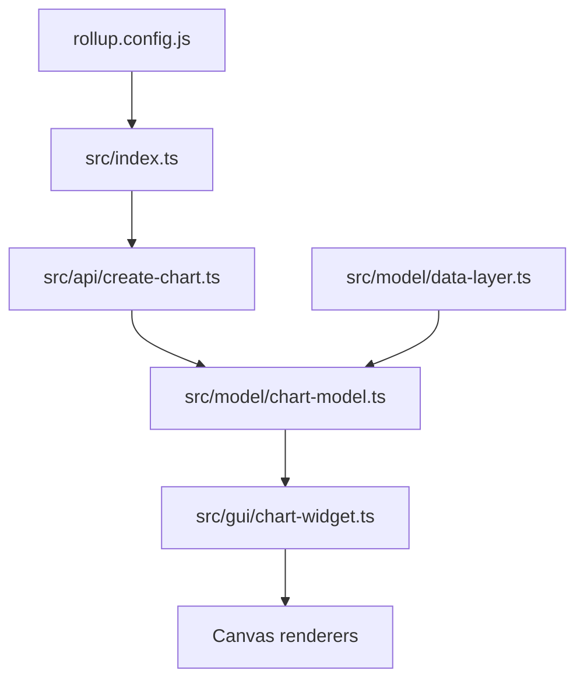

# tradingview/lightweight-charts

> Lightweight TypeScript library for interactive HTML5 financial charts on web pages.

## The problem
Displaying interactive financial series on a web page without weighing down its loading.

## What it actually does
Canvas library: you create a chart, add series (line, area, candlestick, histogram, custom) then `setData`. An internal model handles panes, scales and crosshair; plugins extend the series. Shipped as ES modules and as a standalone bundle (`window.LightweightCharts`). The repository also provides two skills for AI assistants.

## How it is wired


## Trying it
```bash
npm install lightweight-charts
npm install https://pkg.pr.new/lightweight-charts@master
npx skills add tradingview/lightweight-charts
```

## Cost and gotchas
Free, Apache-2.0 license. You have to choose the build variant (with or without dependencies, prod or dev).

## What it is not
Not an analysis platform: display only. No data source provided.

## Alternatives
No alternative named in the README (it points to awesome-tradingview for related projects).

## For you
Watch: handy for a time-series dashboard, with no direct relation to model training.
