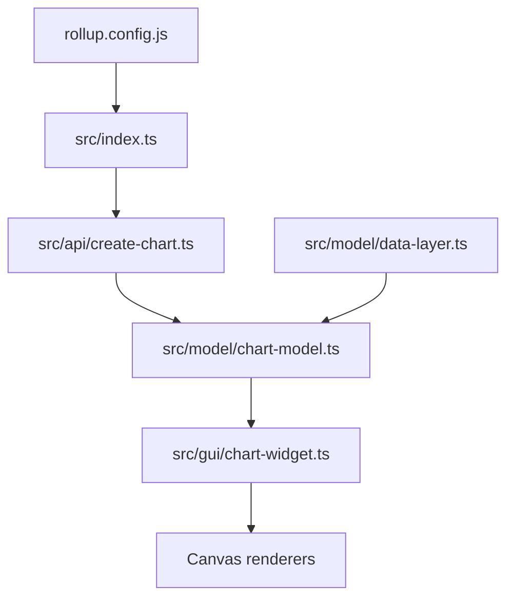

# tradingview/lightweight-charts

> Bibliothèque TypeScript de graphiques financiers HTML5 interactifs, légère, pour pages web.

## Le problème
Afficher des séries financières interactives sur une page web sans alourdir son chargement.

## Ce que ça fait vraiment
Bibliothèque canvas : on crée un graphique, on ajoute des séries (ligne, aire, bougies, histogramme, personnalisées) puis `setData`. Un modèle interne gère panneaux, échelles et croix de visée ; des plugins étendent les séries. Livrée en modules ES et en bundle standalone (`window.LightweightCharts`). Le dépôt fournit aussi deux skills pour assistants IA.

## Comment c'est branché


## Essayer
```bash
npm install lightweight-charts
npm install https://pkg.pr.new/lightweight-charts@master
npx skills add tradingview/lightweight-charts
```

## Coût et pièges
Gratuit, licence Apache-2.0. Il faut choisir la variante de build (avec ou sans dépendances, prod ou dev).

## Ce que ce n'est pas
Pas une plateforme d'analyse : seulement l'affichage. Pas de source de données fournie.

## Alternatives
Aucune alternative nommée dans le README (il renvoie à awesome-tradingview pour des projets liés).

## Pour toi
Surveiller : pratique pour un tableau de bord de séries temporelles, sans rapport direct avec l'entraînement de modèles.

