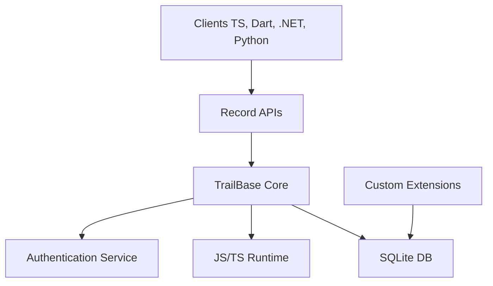

# trailbaseio/trailbase

> Single-executable backend, a Firebase alternative: REST and realtime API, auth, admin interface.

## The problem
A backend for mobile or web (database, auth, API, files) often requires several services to host.

## What it actually does
A single Rust executable based on SQLite (Postgres experimental), with typed REST and realtime APIs, authentication, an admin interface, a WebAssembly runtime via Wasmtime, geospatial support. Clients for JavaScript, Dart, Rust, C#, Swift, Kotlin, Go, Python. Claims sub-millisecond latencies.

## How it is wired


## Trying it
```bash
curl -sSL https://trailbase.io/install.sh | bash
trail run
```

## Cost and gotchas
Free. OSL-3.0 license, copyleft, to be read before commercial use. Building from source requires Rust, node.js, geos, protobuf, pnpm.

## What it is not
Not a managed service: you host it. The provided architecture diagram is generic and mentions V8, whereas the README talks about Wasmtime.

## Alternatives
No alternative named in the README (Firebase serves as a reference point).

## For you
Worth watching: handy for a prototype with a light backend, but the OSL-3.0 license needs checking.
