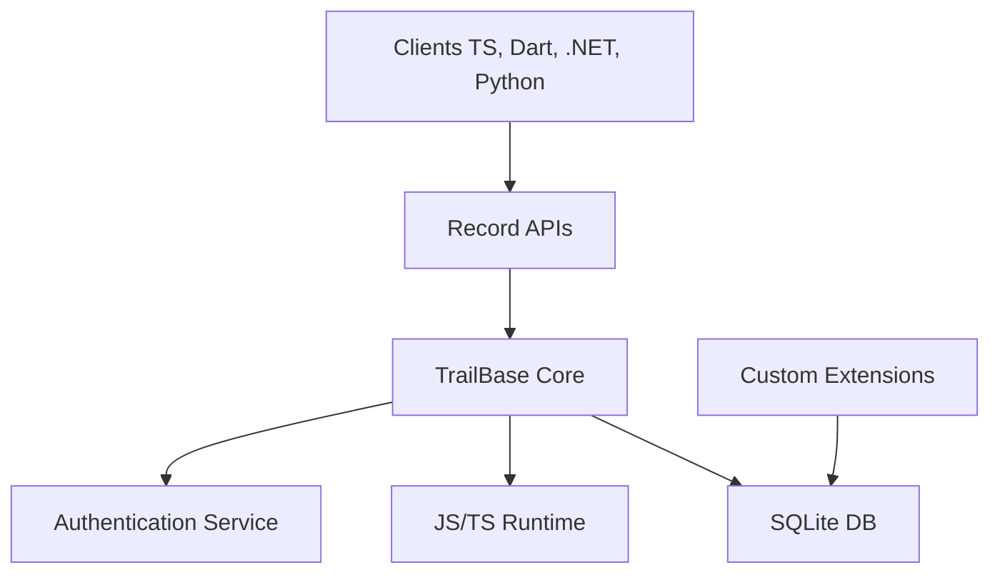

# trailbaseio/trailbase

> Backend à exécutable unique, alternative à Firebase : API REST et temps réel, auth, interface d'administration.

## Le problème
Un backend pour mobile ou web (base, auth, API, fichiers) impose souvent plusieurs services à héberger.

## Ce que ça fait vraiment
Un seul exécutable en Rust basé sur SQLite (Postgres en expérimental), avec API typées REST et temps réel, authentification, interface d'administration, runtime WebAssembly via Wasmtime, support géospatial. Clients JavaScript, Dart, Rust, C#, Swift, Kotlin, Go, Python. Revendique des latences sous la milliseconde.

## Comment c'est branché


## Essayer
```bash
curl -sSL https://trailbase.io/install.sh | bash
trail run
```

## Coût et pièges
Gratuit. Licence OSL-3.0, copyleft, à lire avant un usage commercial. Compilation depuis les sources demande Rust, node.js, geos, protobuf, pnpm.

## Ce que ce n'est pas
Pas un service géré : tu l'héberges. Le diagramme d'architecture fourni est générique et cite V8, alors que le README parle de Wasmtime.

## Alternatives
Aucune alternative nommée dans le README (Firebase sert de repère).

## Pour toi
À surveiller : pratique pour un prototype avec backend léger, mais la licence OSL-3.0 demande une vérification.

