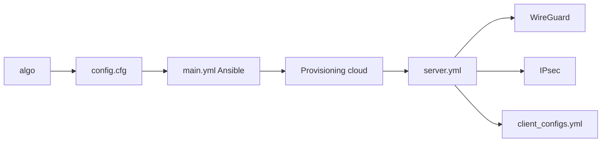

# trailofbits/algo

> Ansible scripts that set up a personal WireGuard and IPsec VPN on a cloud server, for security-conscious users.

## The problem
Commercial VPNs require trusting a provider, and manual setups leave weak settings.

## What it actually does
Deploys, on a cloud provider (DigitalOcean, EC2, Lightsail, Azure, GCE, Hetzner, Vultr...) or on your own Ubuntu, a WireGuard and IPsec IKEv2 server with modern crypto. Generates configuration files, QR codes and Apple profiles, manages users, and offers local DNS with ad blocking, SSH tunneling and privacy settings (logs erased after 7 days).

## How it is wired


## Trying it
```bash
git clone https://github.com/trailofbits/algo.git
./algo
./algo update-users
```

## Cost and gotchas
An account with a cloud provider: the server bill is yours. To add IPsec users later, you must keep the PKI from deployment. AGPL-3.0 license.

## What it is not
Not an anonymity or censorship circumvention tool: the README says so. The cloud provider sees network metadata.

## Alternatives
No alternative named in the README.

## For you
Adopt if you want safe access to your remote machines or GPUs; account for the server cost and the AGPL if you modify and redistribute.
