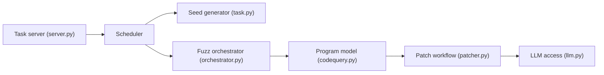

# trailofbits/buttercup

> Trail of Bits' cyber reasoning system that fuzzes open-source code and generates patches with LLM agents.

## The problem
Finding and then fixing vulnerabilities in large repositories takes a lot of human work.

## What it actually does
- Orchestrator, seed generator, fuzzers (on oss-fuzz), program model and multi-agent patcher.
- Built for the DARPA AIxCC challenge; starts on the libpng example.
- Local SigNoz observability, a web interface for tracking tasks, optional LangFuse for LLM costs.
- An LLM budget is configurable.

## How it is wired


## Trying it
```bash
git clone --recurse-submodules https://github.com/trailofbits/buttercup.git
cd buttercup
make setup-local
make deploy
make status
make send-libpng-task
make web-ui
make undeploy
```

## Cost and gotchas
8 cores, 16 GB of RAM, 100 GB of disk. Calls to LLMs (OpenAI, Anthropic, Google) are billed and continue until you run `make undeploy`.

## What it is not
Not a lightweight or guaranteed tool: a competition project, deployed on local Kubernetes.

## Alternatives
No alternative named in the README.

## For you
Watch: an interesting reference for LLM agents applied to code security, but heavy and costly to run.
