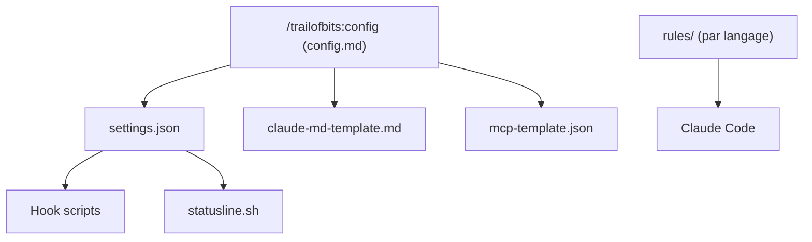

# trailofbits/claude-code-config

> Trail of Bits' settings, hooks, rules and tips for using Claude Code safely.

## The problem
Claude Code is used with broad permissions; without a sandbox, hooks and per-language rules, the agent can read secrets or run dangerous commands.

## What it actually does
The repo provides a `settings.json`, a global `CLAUDE.md` template, per-language rules loaded on demand, hooks (blocking `rm -rf` and pushes to main), a status bar and an MCP template. The `/trailofbits:config` command guides the installation. The README also covers the sandbox, the devcontainer and local models via LM Studio.

## How it is wired


## Trying it
```bash
git clone https://github.com/trailofbits/claude-code-config.git
cd claude-code-config
claude
```

## Cost and gotchas
Free, but you need Claude Code and a long list of tools (Homebrew, uv, Rust, Node). The README recommends `--dangerously-skip-permissions` coupled with a sandbox: do not use it without isolation. The repo declares no license.

## What it is not
Not a program to install but templates to copy and adapt. The hooks are guardrails, not a security boundary, according to the README itself.

## Alternatives
No alternative named in the README, apart from the neighboring repos trailofbits/skills and trailofbits/claude-code-devcontainer, which are complementary.

## For you
Keep an eye on it: a good base of settings if you let Claude Code act without validation, with the caveat of a missing license.
