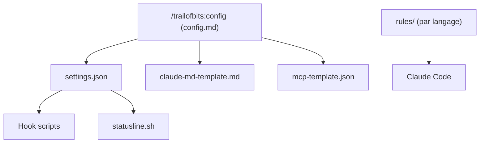

# trailofbits/claude-code-config

> Réglages, hooks, règles et conseils de Trail of Bits pour utiliser Claude Code de façon sûre.

## Le problème
Claude Code s'utilise avec des permissions larges ; sans bac à sable, hooks et règles par langage, l'agent peut lire des secrets ou lancer des commandes dangereuses.

## Ce que ça fait vraiment
Le dépôt fournit un `settings.json`, un modèle de `CLAUDE.md` global, des règles par langage chargées à la demande, des hooks (blocage de `rm -rf` et du push sur main), une barre de statut et un modèle MCP. La commande `/trailofbits:config` guide l'installation. Le README couvre aussi le bac à sable, le devcontainer et les modèles locaux via LM Studio.

## Comment c'est branché


## Essayer
```bash
git clone https://github.com/trailofbits/claude-code-config.git
cd claude-code-config
claude
```

## Coût et pièges
Gratuit, mais il faut Claude Code et une longue liste d'outils (Homebrew, uv, Rust, Node). Le README recommande `--dangerously-skip-permissions` couplé à un bac à sable : à ne pas utiliser sans isolation. Le dépôt ne déclare aucune licence.

## Ce que ce n'est pas
Ce n'est pas un programme à installer mais des modèles à copier et adapter. Les hooks sont des garde-fous, pas une frontière de sécurité, selon le README lui-même.

## Alternatives
Aucune alternative nommée dans le README, hors les dépôts voisins trailofbits/skills et trailofbits/claude-code-devcontainer, complémentaires.

## Pour toi
À surveiller : une bonne base de réglages si tu laisses Claude Code agir sans validation, avec le bémol d'une licence absente.

