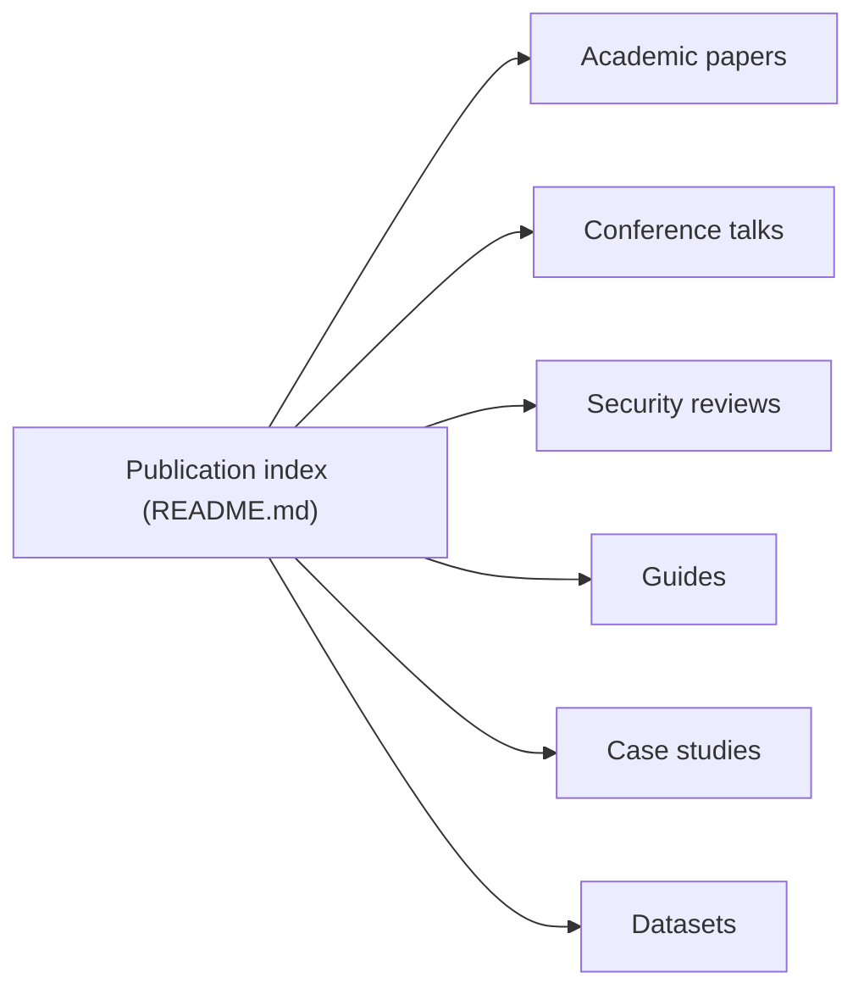

# trailofbits/publications

> Catalog of articles, presentations, audit reports and guides published by Trail of Bits.

## The problem
Finding in one place the public output of a security firm: papers, talks, audits, disclosures.

## What it actually does
- Sorted tables: academic papers, white papers, guides, presentations by theme, podcasts, webinars, public comments.
- Case studies and audits by client and by technology (blockchain, cryptography, cloud, AI/ML).
- Vulnerability disclosures with CVE identifiers.
- A Machine Learning section (prompt injection, pickle files, image scaling).

## How it is wired

## Trying it
No documented command: read the README.

## Cost and gotchas
Free. Many external links; the README is one very long table.

## What it is not
Not a tool or code. Not an up-to-date knowledge base of everything the company publishes.

## Alternatives
No alternative named in the README.

## For you
Worth watching: a good reading source on AI and ML security (pickle, MCP, prompt injection), to consult occasionally.
