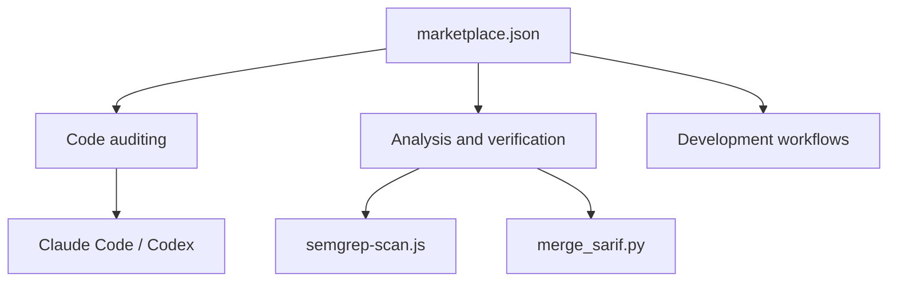

# trailofbits/skills

> Trail of Bits' Claude Code plugin marketplace, for security auditing and code review.

## The problem
Framing an AI assistant for security tasks (audit, static analysis, verification) takes expert instructions that are long to write yourself.

## What it actually does
A catalog of installable plugins: code auditing (C/C++, Rust, GitHub Actions workflows, dependencies), static analysis (CodeQL, Semgrep, SARIF output), verification (mutation testing, property-based testing, constant-time analysis), YARA rules, DWARF, smart contracts, plus development tools (devcontainer, git-cleanup, modern-python). Also usable from Codex and a ChatGPT workspace. The repository also contains scripts (audit.js, collect.py, merge_sarif.py…). Implementations that were not sampled are not detailed.

## How it is wired


## Trying it
```bash
/plugin marketplace add trailofbits/skills
/plugin menu
codex plugin marketplace add trailofbits/skills
codex plugin list
codex plugin add <plugin-name>@trailofbits
```

## Cost and gotchas
The plugins are free, but running them consumes the host agent's subscription or API (Claude Code, Codex). CC-BY-SA-4.0 license, uncommon for code: check before reusing. The plugins act on code you have the right to audit.

## What it is not
Not a standalone scanner: these are instructions and scripts driven by an agent, whose results need human verification. Almost everything targets security, not data work.

## Alternatives
The README cites neighboring repositories from the same publisher: claude-code-config, codex-config, skills-curated, claude-code-devcontainer.

## For you
Keep an eye on it: modern-python, static-analysis and devcontainer-setup can be useful in MLOps, but most of it is geared toward security auditing, and the license needs confirming.
