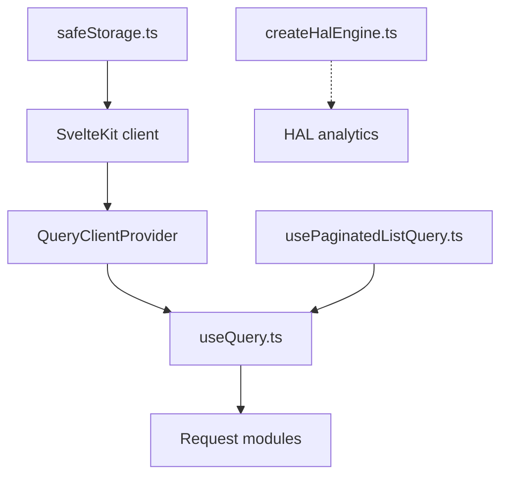

# trakt/trakt-web

> SvelteKit web client for Trakt to track movies and shows, repository open to contributions.

## The problem
The repository exists for contributing to the Trakt client: the README mostly explains how to set up the development environment.

## What it actually does
It is a SvelteKit/Bun client: paginated lists through a query layer, media presentation, streaming service settings, analytics. It calls the Trakt API with a client ID and a secret. GitHub workflows bump dependencies by bisection (`ncu`).

## How it is wired


## Trying it
```bash
bun run install:frozen
bun run client:dev:contrib
```

## Cost and gotchas
Requires Bun, a Trakt account and an API application (`TRAKT_CLIENT_ID`, `TRAKT_CLIENT_SECRET`), with localhost redirect URIs. License present but not identified by GitHub.

## What it is not
Not a standalone tool: it only works with the Trakt service. No back end in this repository.

## Alternatives
No alternative named in the README.

## For you
Ignore: a front end for a show-tracking service, unrelated to data/AI/MLOps.
