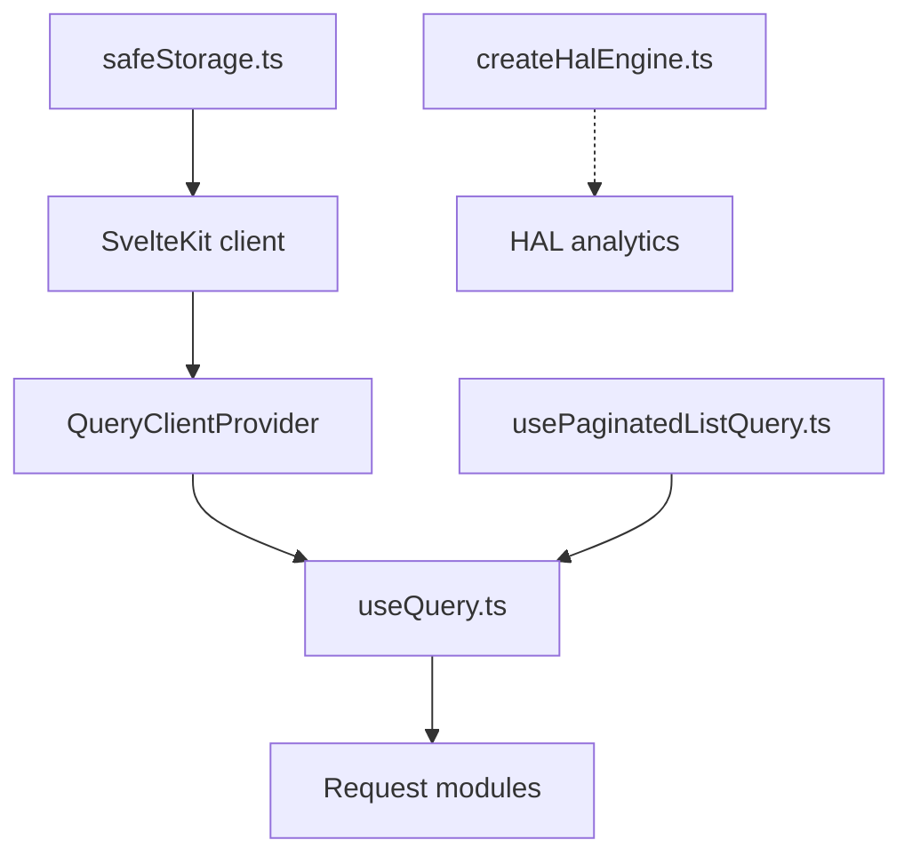

# trakt/trakt-web

> Client web SvelteKit de Trakt pour suivre films et séries, dépôt ouvert aux contributions.

## Le problème
Le dépôt sert à contribuer au client Trakt : le README explique surtout comment configurer l'environnement de développement.

## Ce que ça fait vraiment
C'est un client SvelteKit/Bun : listes paginées via une couche de requêtes, présentation des médias, réglages de services de streaming, analytique. Il appelle l'API Trakt avec un client ID et un secret. Des workflows GitHub montent les dépendances par bissection (`ncu`).

## Comment c'est branché


## Essayer
```bash
bun run install:frozen
bun run client:dev:contrib
```

## Coût et pièges
Il faut Bun, un compte Trakt et une application API (`TRAKT_CLIENT_ID`, `TRAKT_CLIENT_SECRET`), avec les URI de redirection localhost. Licence présente mais non identifiée par GitHub.

## Ce que ce n'est pas
Pas un outil autonome : il ne fonctionne qu'avec le service Trakt. Pas de back-end dans ce dépôt.

## Alternatives
Aucune alternative nommée dans le README.

## Pour toi
Ignorer : un front de service de suivi de séries, sans rapport avec data/IA/MLOps.

