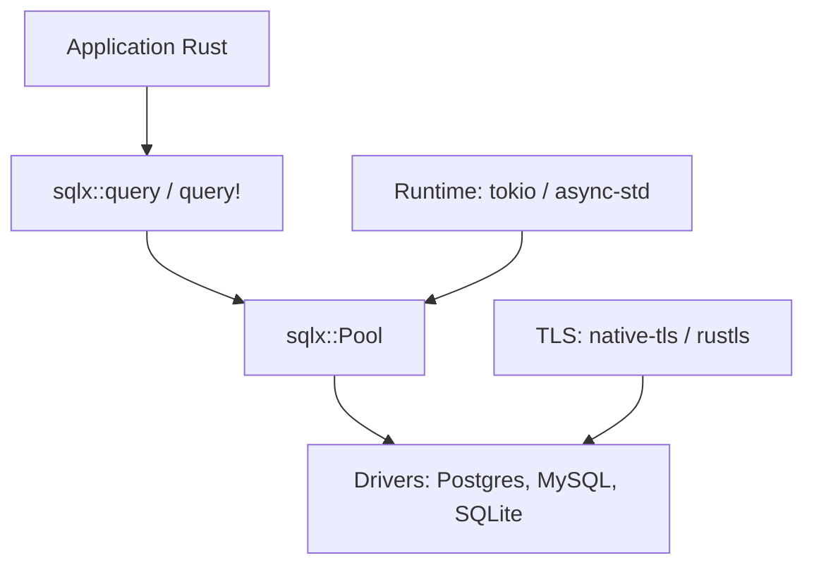

# transact-rs/sqlx

> Async SQL toolkit in Rust, with compile-time checked queries, no ORM.

## The problem
Writing raw SQL in Rust without discovering it is broken at runtime, while staying async.

## What it actually does
The README is identical to that of launchbadge/sqlx (same stars, dates and issues in the catalog: very likely the same repository under another name). Async crate for Postgres, MySQL/MariaDB and SQLite, with pooling, streaming, cached prepared statements, compile-time checked `query!` macros and offline mode.

## How it is wired
No diagram provided; schema inferred from the README.


## Trying it
```bash
# Cargo.toml
sqlx = { version = "0.9", features = [ "runtime-tokio", "tls-native-tls" ] }
DATABASE_URL=mysql://localhost/my_database
```

## Cost and gotchas
Free. Choose a runtime + TLS. The macros require a development database with the same schema, or offline mode.

## What it is not
Not an ORM. The README says "Built with love by The LaunchBadge team": the owner name transact-rs does not appear in the text.

## Alternatives
- SeaORM: async ORM.
- ormx: mapping layer cited by the README.

## For you
Adopt, like launchbadge/sqlx of which this is apparently the duplicate: compile-time checked SQL queries in Rust.
