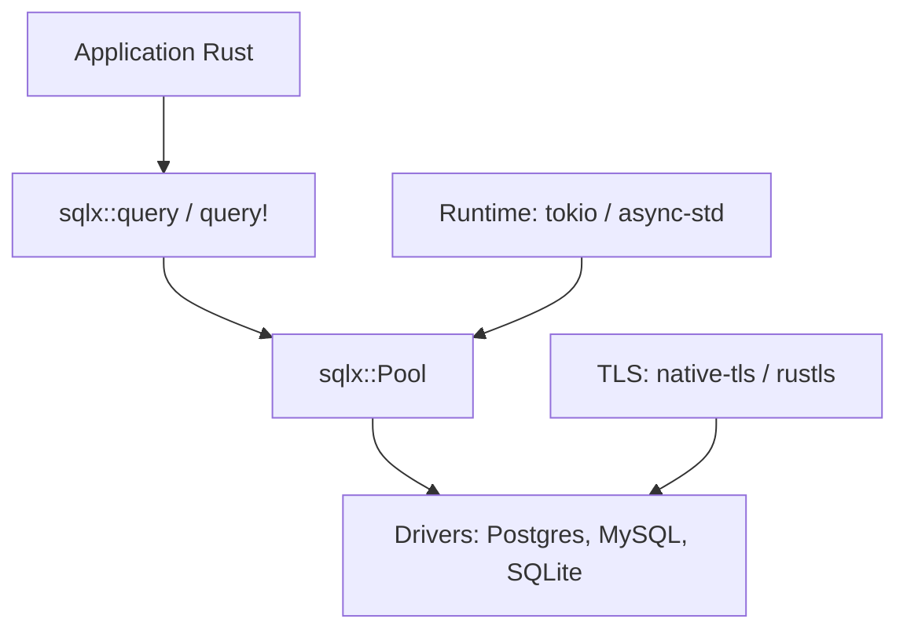

# transact-rs/sqlx

> Boîte à outils SQL asynchrone en Rust, avec requêtes vérifiées à la compilation, sans ORM.

## Le problème
Écrire du SQL brut en Rust sans le découvrir cassé à l'exécution, tout en restant asynchrone.

## Ce que ça fait vraiment
Le README est identique à celui de launchbadge/sqlx (mêmes étoiles, dates et issues dans le catalogue : très probablement le même dépôt sous un autre nom). Crate asynchrone pour Postgres, MySQL/MariaDB et SQLite, avec pool, streaming, requêtes préparées en cache, macros `query!` vérifiées à la compilation et mode hors ligne.

## Comment c'est branché
Aucun diagramme fourni ; schéma déduit du README.


## Essayer
```bash
# Cargo.toml
sqlx = { version = "0.9", features = [ "runtime-tokio", "tls-native-tls" ] }
DATABASE_URL=mysql://localhost/my_database
```

## Coût et pièges
Gratuit. Choisir runtime + TLS. Les macros nécessitent une base de développement au même schéma ou le mode hors ligne.

## Ce que ce n'est pas
Pas un ORM. Le README signale « Built with love by The LaunchBadge team » : ce nom de propriétaire, transact-rs, ne figure pas dans le texte.

## Alternatives
- SeaORM : ORM asynchrone.
- ormx : couche de mapping citée par le README.

## Pour toi
Adopter, comme launchbadge/sqlx dont c'est visiblement le doublon : requêtes SQL vérifiées à la compilation en Rust.

