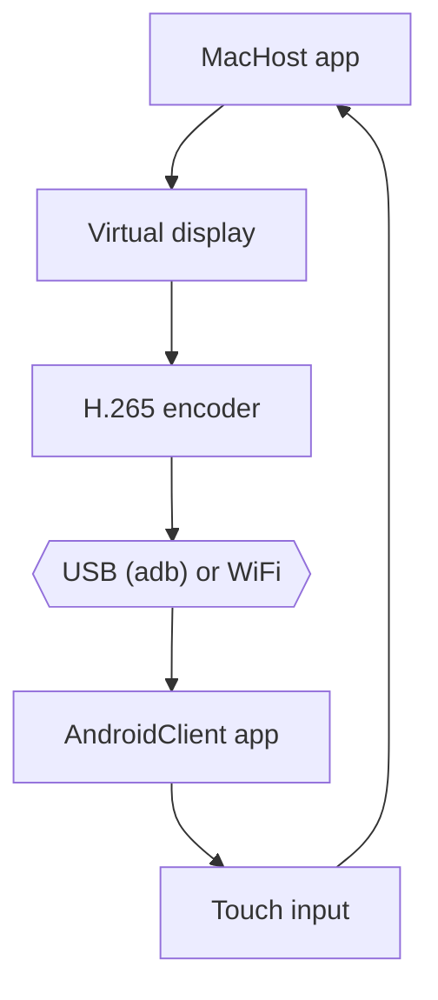

# tranvuongquocdat/SideScreen

> Turns an Android tablet into a second screen for Mac, over USB-C or WiFi.

## The problem
Apple's Sidecar only works with an iPad; Android tablets sit unused as secondary displays.

## What it actually does
A Mac app (menu bar) creates a virtual display, encodes with hardware H.265 and sends the stream to the Android app, which decodes it and sends touch back. USB: `adb reverse` configured automatically. WiFi: one-time pairing by QR code, token generated locally. Settings for resolution, frame rate, bitrate, headless mode at startup.

## How it is wired


## Trying it
```bash
git clone https://github.com/tranvuongquocdat/SideScreen.git
cd SideScreen
cd MacHost && swift build -c release
cd AndroidClient && ./gradlew assembleDebug
brew install --cask android-platform-tools
```

## Cost and gotchas
Free. macOS 13+, `adb`, hardware H.265 decoder on the tablet side. The Mac app is not notarized: you need `sudo xattr -cr /Applications/SideScreen.app`. WiFi adds 10 to 50 ms.

## What it is not
Not a tool for Linux or Windows. The latency figures come from the README, not verified here. No code-based architecture was provided: the diagram above comes from the README.

## Alternatives
- Apple's Sidecar: native but reserved for iPads.

## For you
Ignore: Mac workstation comfort unrelated to data/AI/MLOps, and a single maintainer, 45 open issues.
