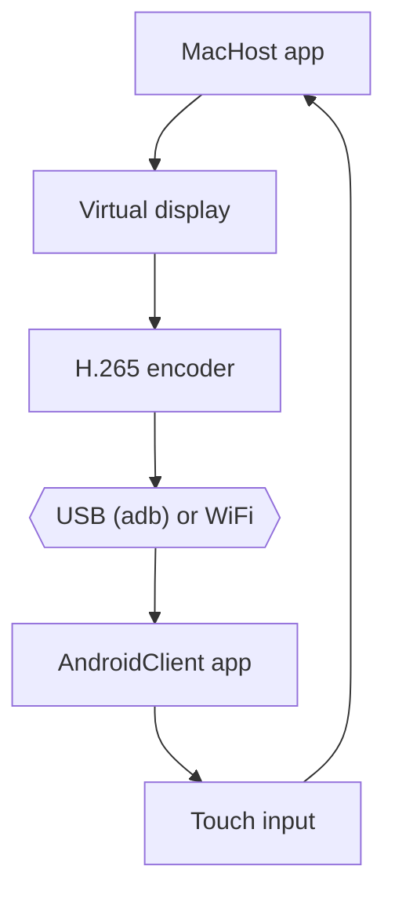

# tranvuongquocdat/SideScreen

> Transforme une tablette Android en second écran pour Mac, en USB-C ou en WiFi.

## Le problème
Le Sidecar d'Apple ne fonctionne qu'avec un iPad ; les tablettes Android restent inutilisées comme écran secondaire.

## Ce que ça fait vraiment
Une app Mac (barre de menus) crée un écran virtuel, encode en H.265 matériel et envoie le flux à l'app Android, qui décode et renvoie le tactile. USB : `adb reverse` configuré automatiquement. WiFi : appairage unique par QR code, jeton généré localement. Réglages de résolution, fréquence, débit, mode headless au démarrage.

## Comment c'est branché


## Essayer
```bash
git clone https://github.com/tranvuongquocdat/SideScreen.git
cd SideScreen
cd MacHost && swift build -c release
cd AndroidClient && ./gradlew assembleDebug
brew install --cask android-platform-tools
```

## Coût et pièges
Gratuit. macOS 13+, `adb`, décodeur H.265 matériel côté tablette. L'app Mac n'est pas notarisée : il faut `sudo xattr -cr /Applications/SideScreen.app`. Le WiFi ajoute 10 à 50 ms.

## Ce que ce n'est pas
Pas un outil pour Linux ou Windows. Les chiffres de latence viennent du README, non vérifiés ici. Aucune architecture d'après le code n'était fournie : le schéma ci-dessus vient du README.

## Alternatives
- Sidecar d'Apple : natif mais réservé aux iPad.

## Pour toi
Ignorer : confort de poste Mac sans lien avec data/IA/MLOps, et mainteneur unique, 45 issues ouvertes.

