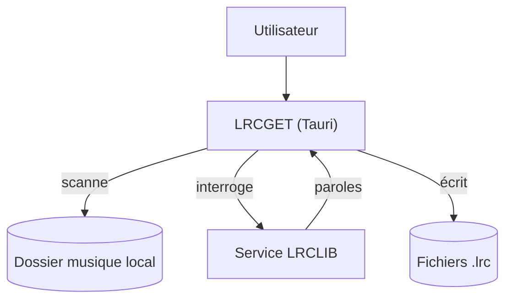

# tranxuanthang/lrcget

> Desktop application that bulk-downloads synchronized LRC lyrics for a local music library.

## The problem
Manually finding and aligning synchronized lyrics for every track in a music library is slow and tedious.

## What it actually does
Scans a music folder, queries the LRCLIB service (of which it is the official client) and saves a `.lrc` file with the same name next to each track. Provides installers for Windows, Linux (Flatpak, deb, rpm, AppImage) and macOS.

## How it is wired
Simplified diagram based on the sheet, no diagram provided.


## Trying it
```shell
cd lrcget
npm install
npm run tauri dev
```

## Cost and gotchas
Free, ready-to-use binaries. Building it yourself requires Rust 1.81+, NodeJS 16.18+ and the C++ build tools native to the OS.

## What it is not
Not an audio transcription or alignment tool: it retrieves already-synchronized lyrics that exist on LRCLIB, it does not generate any. Only works if the track is already listed on that service.

## Alternatives
No alternative named in the README.

## For you
Off-topic for a data/AI/MLOps profile: it is a consumer music-management utility, unrelated to a data or AI workflow.
