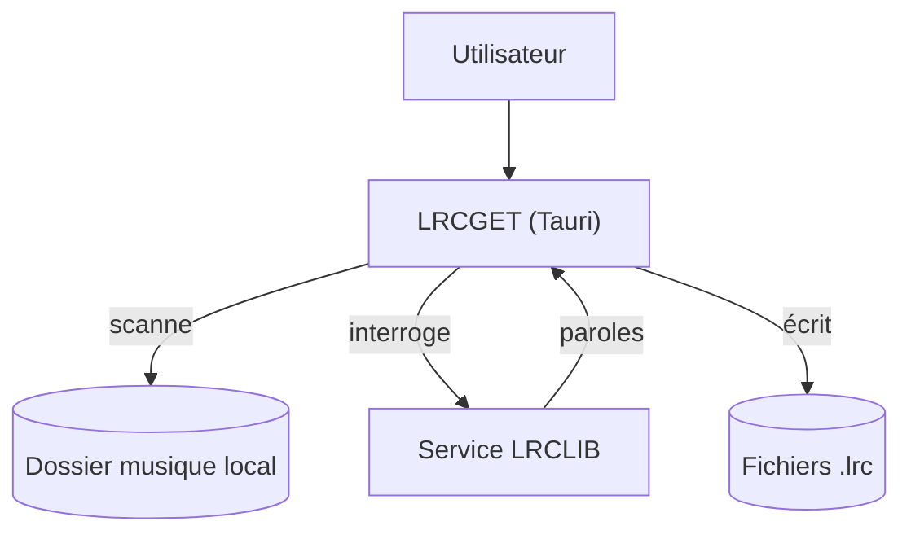

# tranxuanthang/lrcget

> Application de bureau qui télécharge en masse les paroles synchronisées LRC pour une bibliothèque musicale locale.

## Le problème
Trouver et aligner manuellement des paroles synchronisées pour chaque morceau d'une bibliothèque musicale est long et fastidieux.

## Ce que ça fait vraiment
Scanne un dossier de musique, interroge le service LRCLIB (dont c'est le client officiel) et enregistre un fichier `.lrc` du même nom à côté de chaque morceau. Fournit des installeurs pour Windows, Linux (Flatpak, deb, rpm, AppImage) et macOS.

## Comment c'est branché
Schéma simplifié d'après la fiche, sans diagramme fourni.


## Essayer
```shell
cd lrcget
npm install
npm run tauri dev
```

## Coût et pièges
Gratuit, binaires prêts à l'emploi. Compiler soi-même demande Rust 1.81+, NodeJS 16.18+ et les outils de build C++ natifs à l'OS.

## Ce que ce n'est pas
Pas un outil de transcription ou d'alignement audio : il récupère des paroles déjà synchronisées existant sur LRCLIB, il n'en génère pas. Ne fonctionne que si le morceau est déjà référencé sur ce service.

## Alternatives
Aucune alternative nommée dans le README.

## Pour toi
Hors sujet pour un profil data/IA/MLOps : c'est un utilitaire grand public de gestion musicale, sans lien avec un flux de travail data ou IA.

