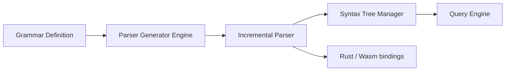

# tree-sitter/tree-sitter

> Parser generator and incremental parsing library, for editors and code tools.

## The problem
Parsing code on every keystroke, tolerating errors, for any language.

## What it actually does
Minimal README (under 800 characters). It describes a parser generator and a library that builds a concrete syntax tree and updates it on every edit. The runtime is pure C, with no dependencies. The README details neither usage nor installation; it points to the documentation, the Rust and Wasm bindings and the CLI.

## How it is wired

Diagram based on the generated explanation, not checked against the code.

## Trying it
No documented command: see the documentation and the CLI.

## Cost and gotchas
Free. Language grammars are separate repositories; not documented in the README.

## What it is not
Not an editor or a semantic analyzer: it produces syntax trees, not an understanding of code.

## Alternatives
No alternative named in the README.

## For you
Keep an eye on it: a useful building block for splitting code in AI tools, but the README is too thin to judge the usage without the docs.
