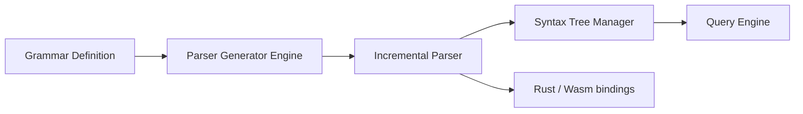

# tree-sitter/tree-sitter

> Générateur d'analyseurs et bibliothèque d'analyse incrémentale, pour éditeurs et outils de code.

## Le problème
Analyser du code à chaque frappe, de façon tolérante aux erreurs, pour n'importe quel langage.

## Ce que ça fait vraiment
README minimal (moins de 800 caractères). Il décrit un générateur d'analyseurs et une bibliothèque qui construit un arbre syntaxique concret et le met à jour à chaque édition. Le runtime est en C pur, sans dépendance. Le README ne détaille ni usage ni installation ; il renvoie à la documentation, aux liaisons Rust et Wasm et à la CLI.

## Comment c'est branché

Diagramme d'après l'explication générée, non vérifiée sur le code.

## Essayer
Aucune commande documentée : voir la documentation et la CLI.

## Coût et pièges
Gratuit. Les grammaires de langage sont des dépôts séparés ; non documenté dans le README.

## Ce que ce n'est pas
Pas un éditeur ni un analyseur sémantique : il produit des arbres syntaxiques, pas de la compréhension de code.

## Alternatives
Aucune alternative nommée dans le README.

## Pour toi
À surveiller : brique utile pour découper du code en outils d'IA, mais le README est trop mince pour juger l'usage sans la doc.

