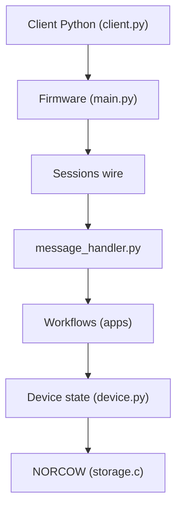

# trezor/trezor-firmware

> Firmware for Trezor hardware wallets, with a Python client library and NORCOW storage.

## The problem
Keeping cryptocurrency keys in a dedicated device, separate from the computer.

## What it actually does
The repository contains the Trezor Core firmware (T, Safe 3, 5, 7), the Trezor One firmware, a standalone cryptographic library, NORCOW storage and the Python client with `trezorctl`. The host sends protobuf requests; the dispatcher runs registered workflows that use the device state and the secure storage.

## How it is wired


## Trying it
```bash
# No command documented in the README: the documentation is in docs/ and on docs.trezor.io.
```

## Cost and gotchas
Free, but building embedded firmware is heavy. A license is present but not identified by GitHub. Many open issues (771).

## What it is not
Not a software wallet: you need a Trezor device. Not a generic cryptography library.

## Alternatives
No alternative named in the README.

## For you
Ignore: crypto wallet firmware, unrelated to a data / AI / MLOps profile.
