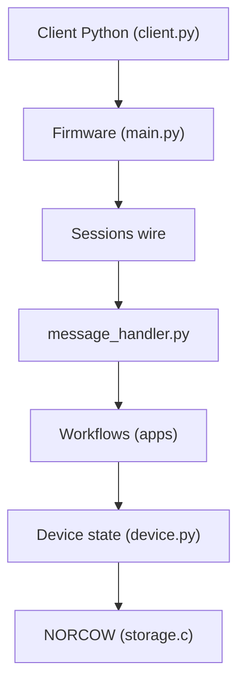

# trezor/trezor-firmware

> Firmware des portefeuilles matériels Trezor, avec bibliothèque cliente Python et stockage NORCOW.

## Le problème
Garder des clés de cryptomonnaies dans un appareil dédié, séparé de l'ordinateur.

## Ce que ça fait vraiment
Le dépôt contient le firmware Trezor Core (T, Safe 3, 5, 7), celui du Trezor One, une bibliothèque cryptographique autonome, le stockage NORCOW et le client Python avec `trezorctl`. L'hôte envoie des requêtes protobuf ; le dispatcher exécute des workflows enregistrés qui utilisent l'état de l'appareil et le stockage sécurisé.

## Comment c'est branché


## Essayer
```bash
# Aucune commande documentée dans le README : la documentation est dans docs/ et sur docs.trezor.io.
```

## Coût et pièges
Gratuit, mais la compilation de firmware embarqué est lourde. Licence présente mais non identifiée par GitHub. Beaucoup d'issues ouvertes (771).

## Ce que ce n'est pas
Pas un portefeuille logiciel : il faut un appareil Trezor. Pas une bibliothèque générique de cryptographie.

## Alternatives
Aucune alternative nommée dans le README.

## Pour toi
À ignorer : firmware de portefeuille crypto, sans rapport avec un profil data / IA / MLOps.

