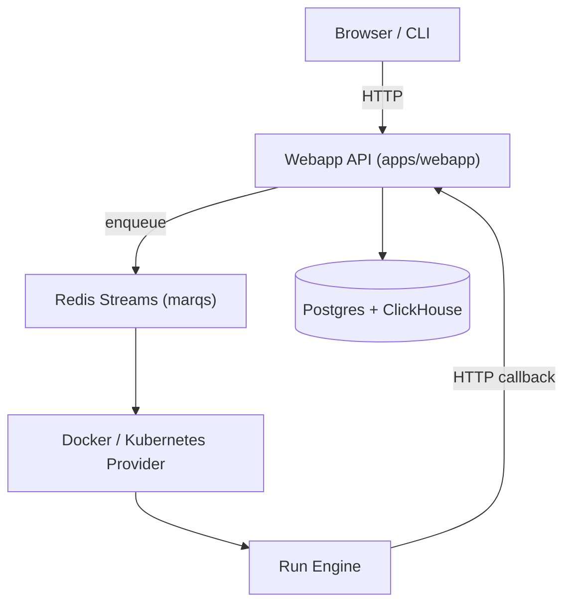

# triggerdotdev/trigger.dev

> Open source TypeScript platform for durable long-running tasks for AI agents and workflows.

## The problem
Serverless platforms impose maximum timeouts and offer little recovery on error for long-running agent tasks.

## What it actually does
You write tasks in your own code with the SDK; they run with no maximum timeout, with retries, queues, durable schedules, checkpoints, pauses for human validation (waitpoints) and real-time monitoring. Build extensions for Python, FFmpeg and browsers. Architecture: Remix webapp, Postgres, ClickHouse, Redis, Docker and Kubernetes providers.

## How it is wired


## Trying it
```ts
import { task } from "@trigger.dev/sdk";

export const helloWorld = task({
  id: "hello-world",
  run: async (payload: { message: string }) => {
    console.log(payload.message);
  },
});
```

## Cost and gotchas
The quick path goes through an account and a project on their cloud (freemium offer, pricing not specified here). Self-hosting is available with Docker Compose or Helm on Kubernetes.

## What it is not
Not an agent framework nor an LLM provider: it runs and tracks your tasks. The managed cloud is a third-party service.

## Alternatives
- AWS Lambda: cited as a platform with maximum timeouts, which Trigger.dev avoids.
- Vercel: same remark on the serverless side.

## For you
Adopt for long, resumable agent pipelines in TypeScript; self-hosting limits the dependence on the SaaS.
