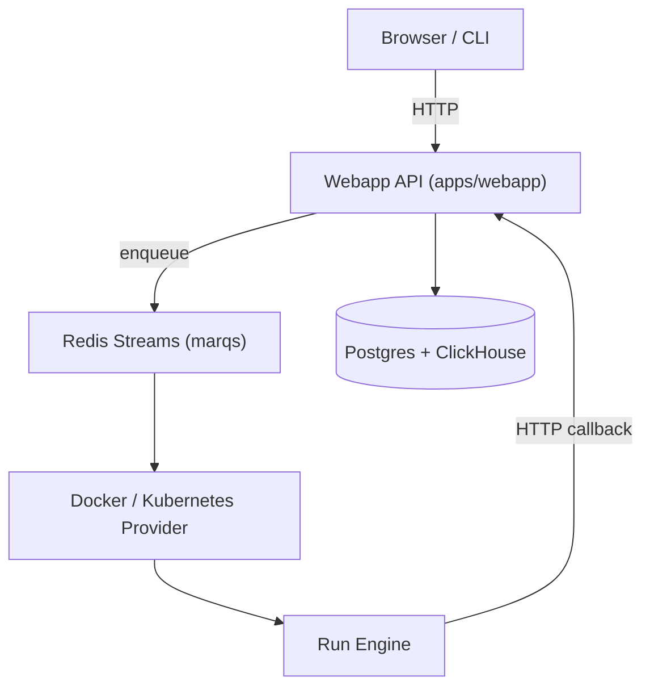

# triggerdotdev/trigger.dev

> Plateforme open source TypeScript de tâches longues durables pour agents IA et workflows.

## Le problème
Les plateformes serverless imposent des délais maximaux et peu de reprise sur erreur pour les tâches d'agents longues.

## Ce que ça fait vraiment
On écrit des tâches dans son code avec le SDK ; elles s'exécutent sans délai maximal, avec reprises, files d'attente, planifications durables, points de contrôle, pauses pour validation humaine (waitpoints) et suivi en temps réel. Extensions de build pour Python, FFmpeg et navigateurs. Architecture : webapp Remix, Postgres, ClickHouse, Redis, fournisseurs Docker et Kubernetes.

## Comment c'est branché


## Essayer
```ts
import { task } from "@trigger.dev/sdk";

export const helloWorld = task({
  id: "hello-world",
  run: async (payload: { message: string }) => {
    console.log(payload.message);
  },
});
```

## Coût et pièges
Le chemin rapide passe par un compte et un projet sur leur cloud (offre freemium, tarifs non précisés ici). L'auto-hébergement existe avec Docker Compose ou Helm sur Kubernetes.

## Ce que ce n'est pas
Pas un framework d'agents ni un fournisseur de LLM : il exécute et suit tes tâches. Le cloud géré est un service tiers.

## Alternatives
- AWS Lambda : cité comme plateforme à délais maximaux, que Trigger.dev évite.
- Vercel : même remarque côté serverless.

## Pour toi
Adopter pour des pipelines d'agents longs et reprenables en TypeScript ; l'auto-hébergement limite la dépendance au SaaS.

