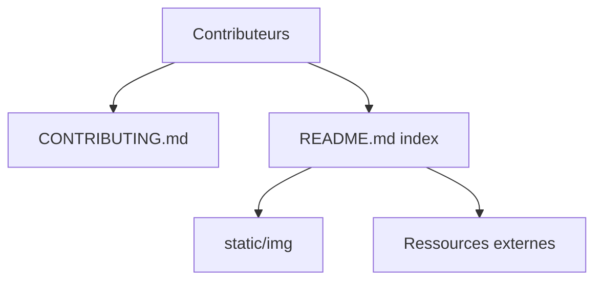

# trimstray/the-book-of-secret-knowledge

> A reference list of command-line tools, web tools, cheat sheets, and one-liners for system administrators, DevOps engineers, and penetration testers.

## The problem
The network, security, and diagnostic tools are scattered; finding the correct tool requires repeating the search process each time.

## What it actually does
A single README serves as an index by chapter: command-line tools (shells, networking, DNS, HTTP, SSL, auditing, debugging, logs, databases), GUI tools, and web tools, followed by manuals, lists, blogs, one-liners, and tips. The repository contains almost exclusively links to external resources.

## How it is wired

## Trying it
No installation required: open the README file on GitHub and follow the table of contents.

## Cost and gotchas
Free. Last update: 2024-11-19. Links or tools listed may be outdated.

## What it is not
Not a runnable tool or a structured course. Focused on system administration and penetration testing, with very little data or AI. The "To-Do" items in the README (list order, shell functions) remain open.

## Alternatives
No alternative is specified in the README (except for internal links within the list).

## For you
Things to watch out for: Useful as a CLI/network debugging aid for troubleshooting a pipeline infrastructure, but not central to data/AI and hasn't been updated in two years.
