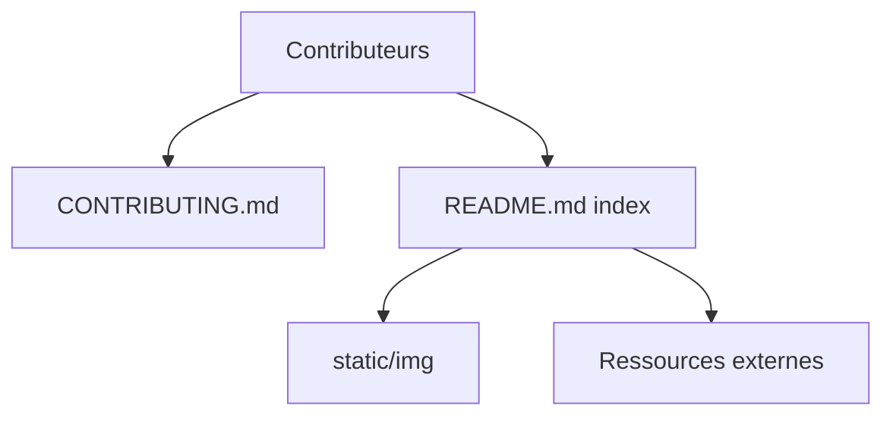

# trimstray/the-book-of-secret-knowledge

> Liste de référence d'outils CLI, web, cheatsheets et one-liners pour admins système, DevOps et pentesters.

## Le problème
Les outils réseau, sécurité et diagnostic sont dispersés ; retrouver le bon utilitaire demande de refaire la recherche à chaque fois.

## Ce que ça fait vraiment
Un seul README sert d'index par chapitres : outils CLI (shells, réseau, DNS, HTTP, SSL, audit, debug, logs, bases), outils GUI et outils web, puis manuels, listes, blogs, one-liners, astuces. Le dépôt ne contient presque que des liens vers des ressources externes.

## Comment c'est branché

## Essayer
Rien à installer : ouvrir le README sur GitHub et suivre la table des matières.

## Coût et pièges
Gratuit. Dernier push le 2024-11-19 : des liens ou outils listés peuvent être périmés.

## Ce que ce n'est pas
Pas un outil exécutable ni un cours structuré. Orienté sysadmin et pentest, très peu data/IA. La ToDo du README (ordre des listes, fonctions shell) reste ouverte.

## Alternatives
Aucune alternative nommée dans le README (hors liens internes à la liste).

## Pour toi
À surveiller : utile comme aide-mémoire CLI/réseau pour déboguer l'infra d'un pipeline, mais hors cœur data/IA et plus mis à jour depuis deux ans.

