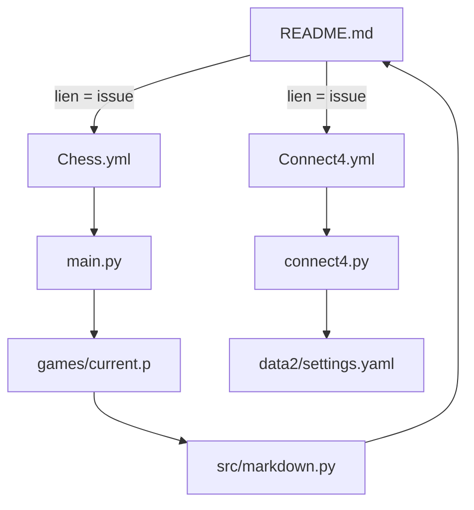

# trinib/trinib

> Self-rewriting GitHub profile README: chess and Connect 4 games played by visitors.

## The problem
A static GitHub profile has nothing interactive. This repository turns it into an animated showcase, unrelated to data or AI.

## What it actually does
Each move is a link that opens an issue; a GitHub Action runs a Python script (`main.py`, `connect4.py`) that updates the state in `games/`, regenerates the README board and commits. Side workflows add quotes, metrics and a snake animation.

## How it is wired


## Trying it
```bash
# Aucune commande documentée : on joue en cliquant sur un lien de coup dans le README.
```

## Cost and gotchas
Free. It is not installable: it is one person's profile repository, whose operation depends on GitHub Actions and issues.

## What it is not
Not a reusable chess engine nor a work tool. Much of the README is decoration (ASCII, badges, quotes).

## Alternatives
No alternative named in the README.

## For you
Ignore: a profile curiosity with no value for data/AI work, unless you want to copy the "README driven by issues and Actions" principle.
