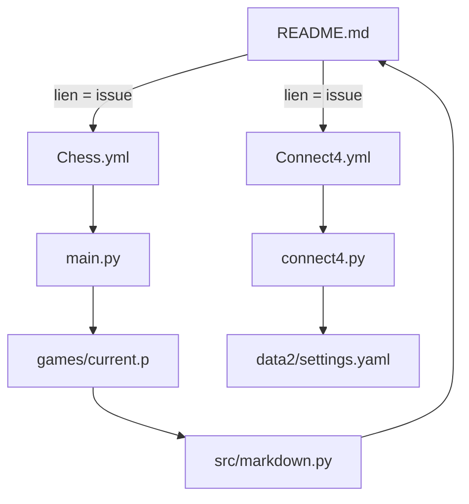

# trinib/trinib

> README de profil GitHub qui se réécrit seul : parties d'échecs et de Puissance 4 jouées par les visiteurs.

## Le problème
Un profil GitHub statique n'a rien d'interactif. Ce dépôt en fait une vitrine animée, sans rapport avec la data ou l'IA.

## Ce que ça fait vraiment
Chaque coup est un lien qui ouvre une issue ; une GitHub Action lance un script Python (`main.py`, `connect4.py`) qui met à jour l'état dans `games/`, régénère le tableau du README et commite. Des workflows annexes ajoutent citations, métriques et animation snake.

## Comment c'est branché


## Essayer
```bash
# Aucune commande documentée : on joue en cliquant sur un lien de coup dans le README.
```

## Coût et pièges
Gratuit. Ce n'est pas installable : c'est le dépôt de profil d'une personne, dont le fonctionnement dépend des GitHub Actions et des issues.

## Ce que ce n'est pas
Pas un moteur d'échecs réutilisable ni un outil de travail. Beaucoup du README est du décor (ASCII, badges, citations).

## Alternatives
Aucune alternative nommée dans le README.

## Pour toi
À ignorer : c'est une curiosité de profil sans valeur pour un travail data/IA, sauf si tu veux copier le principe « README piloté par issues et Actions ».

