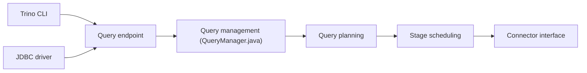

# trinodb/trino

> Fast distributed SQL engine for big data analytics, querying varied sources through connectors.

## The problem
Analyzing data spread across several systems requires moving it or writing custom integrations.

## What it actually does
A client (CLI, JDBC driver) submits SQL; the server handles the query (QueryManager), plans it, schedules the stages, then runs the tasks in a distributed way. Connectors (for example BigQuery) expose external systems. The README mostly covers building and development; analysis and planning are not detailed.

## How it is wired


## Trying it
```bash
./mvnw clean install -DskipTests
client/trino-cli/target/trino-cli-*-executable.jar
# puis : SELECT * FROM system.runtime.nodes;
# et :   SELECT * FROM tpch.tiny.region;
```

## Cost and gotchas
Free. Building requires Java 25 and Docker; the first build is long. 2,734 open issues. The README points to the manual for deployment.

## What it is not
Not a storage database: it queries sources. Not designed for transactions.

## Alternatives
No alternative named in the README.

## For you
Adopt for a federated SQL layer over a data lake: Apache-2.0, strong activity, common usage in data engineering.
