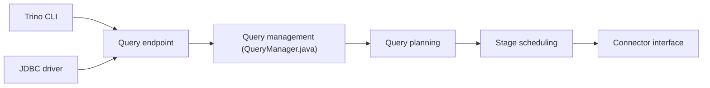

# trinodb/trino

> Moteur SQL distribué rapide pour l'analytique big data, interrogeant des sources variées via des connecteurs.

## Le problème
Analyser des données réparties sur plusieurs systèmes demande de les déplacer ou d'écrire des intégrations sur mesure.

## Ce que ça fait vraiment
Un client (CLI, pilote JDBC) soumet du SQL ; le serveur gère la requête (QueryManager), la planifie, ordonne les étapes, puis exécute les tâches de façon distribuée. Des connecteurs (par exemple BigQuery) exposent les systèmes externes. Le README couvre surtout la compilation et le développement ; analyse et planification ne sont pas détaillées.

## Comment c'est branché


## Essayer
```bash
./mvnw clean install -DskipTests
client/trino-cli/target/trino-cli-*-executable.jar
# puis : SELECT * FROM system.runtime.nodes;
# et :   SELECT * FROM tpch.tiny.region;
```

## Coût et pièges
Gratuit. Compilation avec Java 25 et Docker ; premier build long. 2 734 issues ouvertes. Le README renvoie au manuel pour le déploiement.

## Ce que ce n'est pas
Pas une base de stockage : il interroge des sources. Pas conçu pour la transaction.

## Alternatives
Aucune alternative nommée dans le README.

## Pour toi
À adopter pour une couche SQL fédérée sur lac de données : Apache-2.0, activité forte, usage courant en data engineering.

