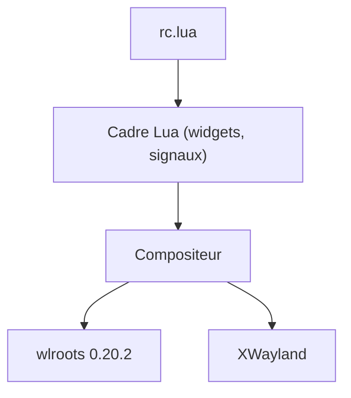

# trip-zip/somewm

> A Wayland compositor written in Lua, compatible with AwesomeWM configurations, for customizing your Linux desktop.

## The problem
Building your own Wayland desktop (layouts, widgets, shortcuts, window rules) requires a scriptable framework.

## What it actually does
SomeWM provides a widget system, a signal-based object model and a compositor built on wlroots 0.20.2, compiled together with it. It runs AwesomeWM configurations (shortcuts, rules, themes) and is driven from `rc.lua` or the command line. The 2.x branch removes some widget APIs; 1.4 keeps them.

## How it is wired
Simplified diagram based on the sheet, no diagram provided.


## Trying it
```bash
git clone https://github.com/trip-zip/somewm
cd somewm
make
sudo make install
dbus-run-session somewm
somewm --check
```

## Cost and gotchas
Free. You need a C build toolchain, Xwayland and libraries (wayland, libdrm, xkbcommon, pixman); some are downloaded at build time. A license is present but not identified by GitHub.

## What it is not
It is not a full desktop environment nor a data tool; it does not run on macOS or Windows.

## Alternatives
- AwesomeWM: whose Lua API somewm reuses.

## For you
Ignore: a personal Linux desktop choice, unrelated to your data / AI work.
