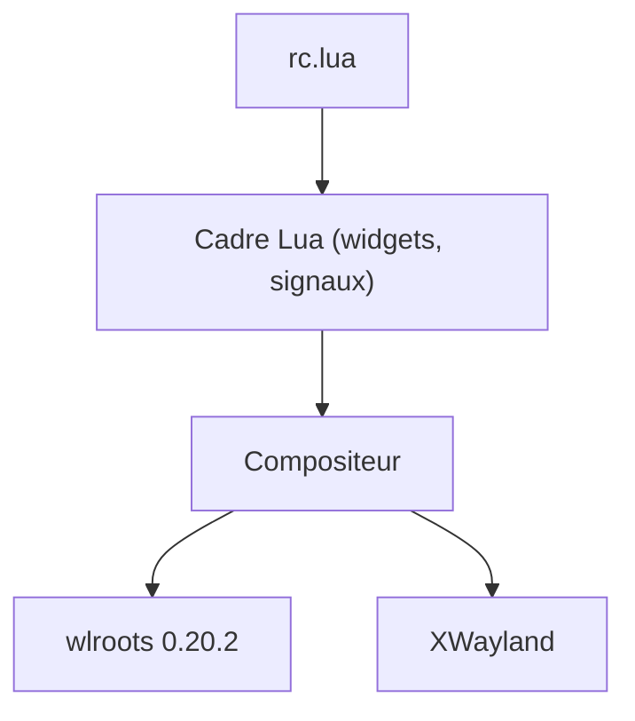

# trip-zip/somewm

> Compositeur Wayland en Lua, compatible avec les configurations AwesomeWM, pour personnaliser son bureau Linux.

## Le problème
Construire son bureau Wayland (agencements, widgets, raccourcis, règles de fenêtres) demande un cadre scriptable.

## Ce que ça fait vraiment
SomeWM fournit un système de widgets, un modèle d'objets à signaux et un compositeur bâti sur wlroots 0.20.2, compilé avec lui. Il exécute des configurations AwesomeWM (raccourcis, règles, thèmes) et se pilote depuis `rc.lua` ou la ligne de commande. La branche 2.x retire certaines API de widgets ; la 1.4 les garde.

## Comment c'est branché
Schéma simplifié d'après la fiche, sans diagramme fourni.


## Essayer
```bash
git clone https://github.com/trip-zip/somewm
cd somewm
make
sudo make install
dbus-run-session somewm
somewm --check
```

## Coût et pièges
Gratuit. Il faut une chaîne de compilation C, Xwayland et des bibliothèques (wayland, libdrm, xkbcommon, pixman) ; certaines sont téléchargées à la compilation. Licence présente mais non identifiée par GitHub.

## Ce que ce n'est pas
Ce n'est pas un environnement de bureau complet ni un outil de data ; il ne tourne pas sous macOS ou Windows.

## Alternatives
- AwesomeWM : dont somewm reprend l'API Lua.

## Pour toi
À ignorer : choix de bureau Linux personnel, sans lien avec ton travail data / IA.

