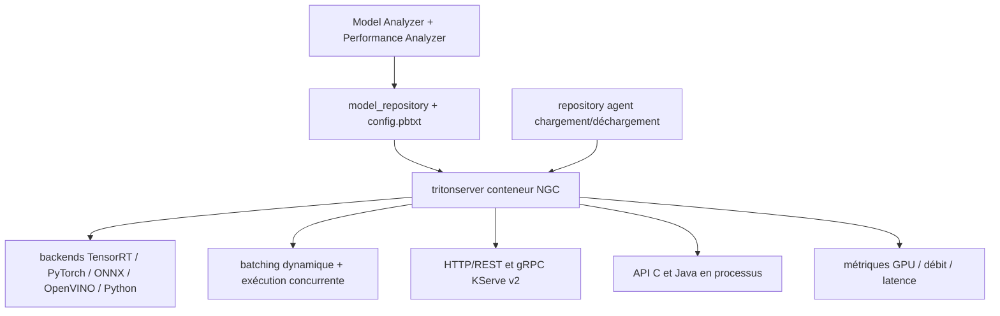

# triton-inference-server/server

> NVIDIA's multi-framework inference server for deploying models in the cloud, in the datacenter or at the edge.

## The problem
Every framework has its own inference server, so there are as many stacks to operate as there are types of models.
Getting throughput requires dynamic batching and concurrent execution, which are rarely provided by default.

## What it actually does
Serves TensorRT, PyTorch, ONNX, OpenVINO, Python and RAPIDS FIL models from a single model repository.
Concurrent model execution, dynamic batching, and sequence batching with implicit state management for stateful models.
Pipelines through Model Ensemble or Business Logic Scripting; custom backends in C/C++ or Python; decoupled backends (several responses, or none, for one request).
HTTP/REST and gRPC protocols based on KServe v2, C and Java APIs for in-process integration, GPU utilization, throughput and latency metrics.

## How it is wired


## Trying it
```bash
git clone -b r26.08 https://github.com/triton-inference-server/server.git
cd server/docs/examples
./fetch_models.sh
docker run --gpus=1 --rm --net=host -v ${PWD}/model_repository:/models nvcr.io/nvidia/tritonserver:26.08-py3 tritonserver --model-repository=/models --model-control-mode explicit --load-model densenet_onnx
docker run -it --rm --net=host nvcr.io/nvidia/tritonserver:26.08-py3-sdk /workspace/install/bin/image_client -m densenet_onnx -c 3 -s INCEPTION /workspace/images/mug.jpg
```

## Cost and gotchas
The server is open and free; images come through NGC and enterprise support falls under NVIDIA AI Enterprise, which is paid.
Version pitfall: the `main` branch is under development, the released version is 2.72.0 / container 26.08 — use the `r26.08` branch. Not all backends are available on all platforms: check the support matrix.

## What it is not
Not LLM-specialized: it is a general-purpose inference server, and KV cache and continuous batching are not its focus.
Not GPU-dependent in theory — a CPU mode exists — but the whole README is NVIDIA-oriented.
Not an optimization tool: Model Analyzer and Performance Analyzer are separate tools.

## Alternatives
No named alternative; the cited repositories (backend, fil_backend, python_backend, kserve) are components.

## For you
The foundation if you serve heterogeneous non-LLM models; for generative text, look elsewhere first.
