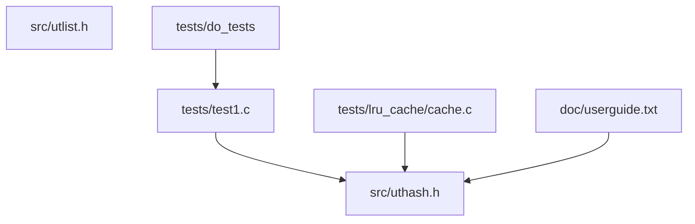

# troydhanson/uthash

> Header-only C macros: hash table, lists, arrays, strings, stacks, ring buffers.

## The problem
C has no hash table or lists in its standard library.

## What it actually does
The README contains only a link to the documentation. Judging from the code, the library fits in headers under `src`: `uthash.h`, `utlist.h`, `utarray.h`, `utstring.h`, `utstack.h`, `utringbuffer.h`. The numbered tests in `tests` are run by `do_tests`, and `doc` contains the guides.

## How it is wired

## Trying it
No documented command: copy the desired header into your project and include it.

## Cost and gotchas
Free. License detected but not identified by GitHub: to be checked. The README content is insufficient to judge further.

## What it is not
Not a compiled library: nothing to link. Not a Python or data tool.

## Alternatives
No alternative named in the README.

## For you
Ignore: useful for writing C, rarely in data or AI work.
