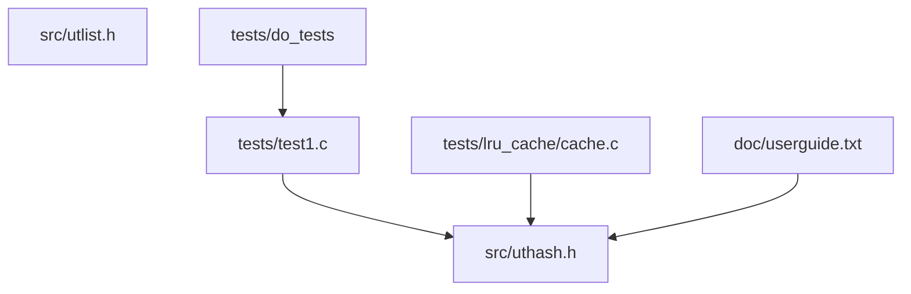

# troydhanson/uthash

> Macros C en-têtes seulement : table de hachage, listes, tableaux, chaînes, piles, tampons circulaires.

## Le problème
Le C n'a pas de table de hachage ni de listes dans sa bibliothèque standard.

## Ce que ça fait vraiment
Le README ne contient qu'un lien vers la documentation. D'après le code, la bibliothèque tient dans des en-têtes de `src` : `uthash.h`, `utlist.h`, `utarray.h`, `utstring.h`, `utstack.h`, `utringbuffer.h`. Les tests numérotés de `tests` sont lancés par `do_tests`, et `doc` contient les guides.

## Comment c'est branché

## Essayer
Aucune commande documentée : copier l'en-tête voulu dans son projet et l'inclure.

## Coût et pièges
Gratuit. Licence détectée mais non identifiée par GitHub : à vérifier. Matière du README insuffisante pour juger davantage.

## Ce que ce n'est pas
Pas une bibliothèque compilée : rien à lier. Pas un outil Python ni data.

## Alternatives
Aucune alternative nommée dans le README.

## Pour toi
Ignorer : utile pour écrire du C, rarement dans un travail data ou IA.

