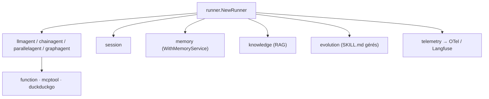

# trpc-group/trpc-agent-go

> Full Go framework for building production-grade agent systems.

## The problem
Writing an agent in Go forces a choice between a rough LangChain port and rewriting everything: sessions, memory, RAG, tracing, evaluation.

## What it actually does
Brings together in a native Go stack LLM agents, graph workflows, tool calling, session and memory state, knowledge retrieval, self-evolution, evaluation and OpenTelemetry observability. The `GraphAgent` offers typed workflows with multi-condition routing, presented as the functional equivalent of LangGraph for Go. Four ready-to-compose agents: `LLMAgent`, `ChainAgent` (sequential), `ParallelAgent` (concurrent, merging results), `CycleAgent` (loops until a stop condition). Agent Skills follow the `SKILL.md` specification with isolated execution. Self-evolution reviews finished sessions in the background, extracts reusable procedures, passes them through quality gates and republishes them as managed skills. Protocols: AG-UI for frontends, A2A between agents, MCP for tools.

## How it is wired


## Trying it
```bash
git clone https://github.com/trpc-group/trpc-agent-go.git
cd trpc-agent-go
export OPENAI_API_KEY="your-api-key-here"
cd examples/runner
go run . -model="gpt-4o-mini" -streaming=true
go test ./...
go vet ./...
```

## Cost and gotchas
Go 1.21+, an LLM API key at your expense. Two documented pitfalls. First, cancellation: do not "break" your event loop; cancel the context then keep draining the channel until it closes, otherwise the agent's goroutine may stay blocked on a write. Second, skills: if you use `WithCodeExecutor` only for `skill_run`, you must set `llmagent.WithEnableCodeExecutionResponseProcessor(false)`, otherwise code blocks present in the assistant's text run on their own.

## What it is not
Not a turnkey product: it is a framework to compile into your service. Nor is it a port: the API is designed Go-style (contexts, channels, cancellation). The "openclaw" gateway example is minimal, with basic security checks.

## Alternatives
- ADK, Agno, CrewAI, AutoGen: cited as sources of inspiration, all outside Go.
- LangGraph, to which `GraphAgent` claims functional equivalence.

## For you
The framework to look at if your production services are in Go and you refuse to add Python.
