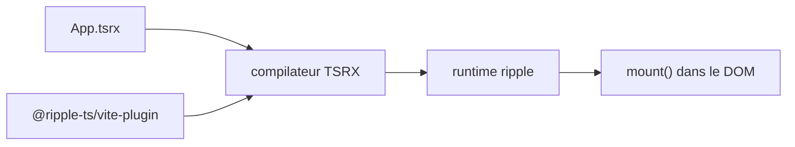

# trueadm/ripple

> TypeScript UI framework with fine-grained reactivity and `.tsrx` files, for front-end developers.

## The problem
UI frameworks mix JSX, state and styles in a way that weighs on the component-side TypeScript.

## What it actually does
Components in `.tsrx` with native control flow (`@if`, `@for`, `@try`), state via `track()` and `.value`, reactive collections (`RippleArray`, `RippleMap`...), automatically scoped styles, context, portals, server modules, SSR and hydration. The TSRX compiler can also target React, Preact, Solid and Vue.

## How it is wired


## Trying it
```bash
npx create-ripple
cd my-app
npm install
npm run dev
```

## Cost and gotchas
Free. Project-specific syntax; editor/Prettier/ESLint tooling to adopt along with it.

## What it is not
Not an established framework like React or Svelte: the author is the only maintainer cited, and the `@{...}` syntax forces you to learn a dialect.

## Alternatives
- Svelte 5, Solid, Vue, React: cited as targets or references; larger ecosystems.

## For you
Ignore for data/AI: a niche front-end framework, unrelated to your usual dashboards.
