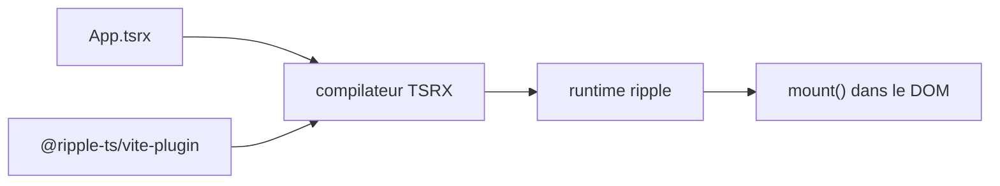

# trueadm/ripple

> Framework UI TypeScript à réactivité fine et fichiers `.tsrx`, pour développeurs front.

## Le problème
Les frameworks UI mêlent JSX, états et styles de façon qui pèse sur le TypeScript côté composant.

## Ce que ça fait vraiment
Composants en `.tsrx` avec contrôle de flux natif (`@if`, `@for`, `@try`), état via `track()` et `.value`, collections réactives (`RippleArray`, `RippleMap`…), styles à portée automatique, contexte, portails, modules serveur, SSR et hydratation. Le compilateur TSRX peut aussi cibler React, Preact, Solid et Vue.

## Comment c'est branché


## Essayer
```bash
npx create-ripple
cd my-app
npm install
npm run dev
```

## Coût et pièges
Gratuit. Syntaxe propre au projet, outillage éditeur/Prettier/ESLint à adopter avec lui.

## Ce que ce n'est pas
Pas un framework établi comme React ou Svelte : l'auteur en est le seul mainteneur cité, et la syntaxe `@{...}` oblige à apprendre un dialecte.

## Alternatives
- Svelte 5, Solid, Vue, React : cités comme cibles ou références ; plus larges écosystèmes.

## Pour toi
À ignorer pour la data/IA : un framework front de niche, sans rapport avec tes dashboards courants.

